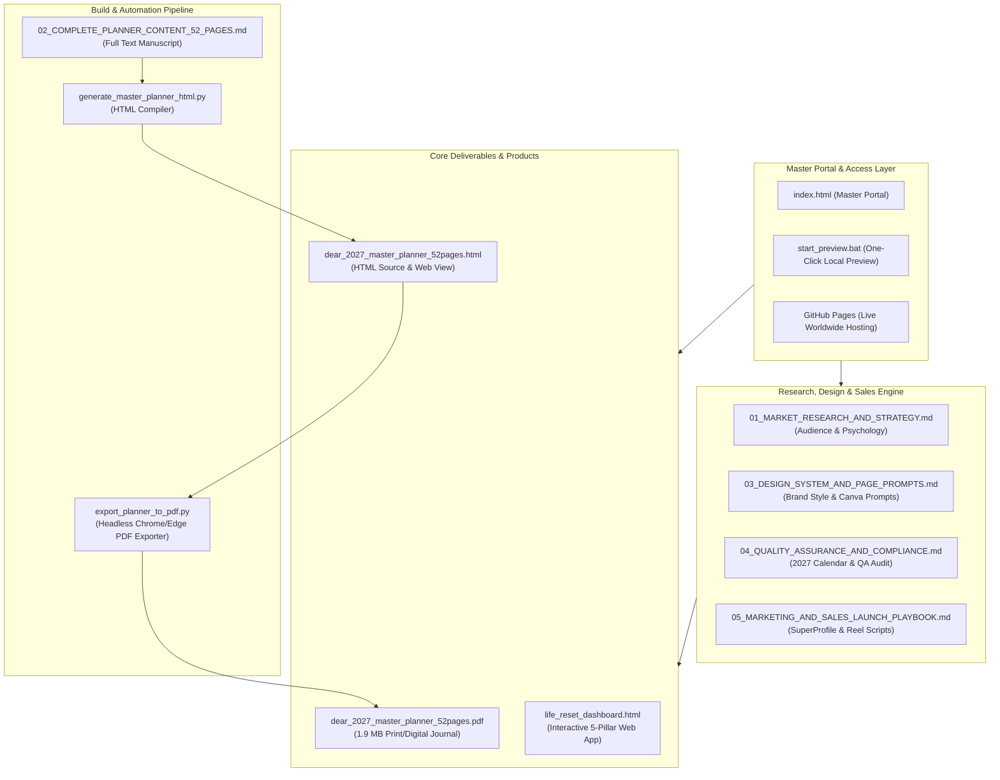
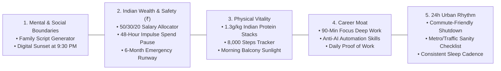
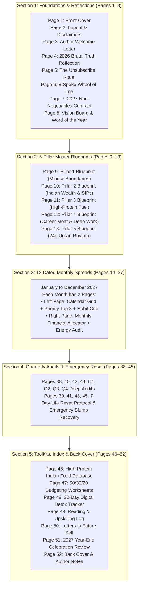
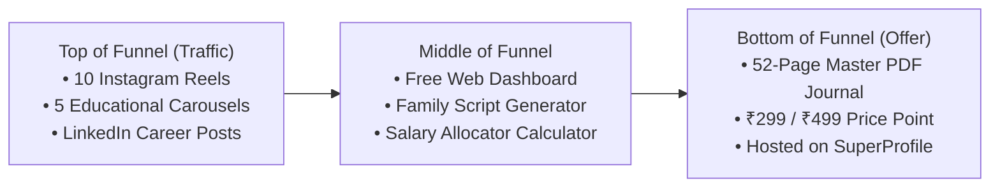

# MASTER PROJECT MAP: "DEAR 2027, I'M READY."
> **Author & Creator:** Kanchan Pathare  
> **Target Audience:** Indian Youth (Ages 18–35: Students, Job Seekers, Young Working Professionals)  
> **GitHub Repository:** [kanchan-1010/ebook-](https://github.com/kanchan-1010/ebook-)  
> **Workspace Path:** `c:\Users\Asus\Downloads\ebook\`  

---

## 🗺️ 1. High-Level Ecosystem Architecture

---

## 📂 2. Master Repository File Map

| File / Directory | Category | Size / Format | Primary Function & Role |
|---|---|---|---|
| [index.html](index.html) | **User Portal** | ~11 KB (HTML5) | Central dashboard connecting the web app, PDF downloads, and strategic guides. |
| [life_reset_dashboard.html](life_reset_dashboard.html) | **Interactive App** | ~58 KB (HTML/JS) | 5-pillar client-side web application with local storage persistence. |
| [dear_2027_master_planner_52pages.pdf](dear_2027_master_planner_52pages.pdf) | **Commercial Product** | 1.9 MB (PDF) | Publication-grade A4 PDF formatted with 22mm binding edge margins. |
| [dear_2027_master_planner_52pages.html](dear_2027_master_planner_52pages.html) | **Web Journal** | ~200 KB (HTML/CSS) | Complete 52-page styled journal view with sample data & print controls. |
| [generate_master_planner_html.py](generate_master_planner_html.py) | **Compiler** | ~81 KB (Python) | Parses the markdown manuscript and compiles the 52-page HTML document. |
| [export_planner_to_pdf.py](export_planner_to_pdf.py) | **Exporter** | ~1.7 KB (Python) | Headless browser automation script to render and print A4 PDF. |
| [start_preview.bat](start_preview.bat) | **Launcher** | Batch Script | One-click Windows runner to launch local HTTP server and browser. |
| [start_server.py](start_server.py) | **Server** | ~1.2 KB (Python) | Zero-dependency local development server with auto-port discovery. |
| [00_QUICKSTART_AND_EXECUTION_GUIDE.md](00_QUICKSTART_AND_EXECUTION_GUIDE.md) | **Handbook** | ~4.5 KB (Markdown) | 90-day implementation cadence and detailed instructions. |
| [01_MARKET_RESEARCH_AND_STRATEGY.md](01_MARKET_RESEARCH_AND_STRATEGY.md) | **Strategy** | ~18 KB (Markdown) | Indian youth market analysis, buyer personas (Rohan & Priya), and positioning. |
| [02_COMPLETE_PLANNER_CONTENT_52_PAGES.md](02_COMPLETE_PLANNER_CONTENT_52_PAGES.md) | **Manuscript** | ~43 KB (Markdown) | Verbatim source text for every single page from Page 1 to Page 52. |
| [03_DESIGN_SYSTEM_AND_PAGE_PROMPTS.md](03_DESIGN_SYSTEM_AND_PAGE_PROMPTS.md) | **Design** | ~22 KB (Markdown) | Color palette, typography hierarchy, and 52 individual Canva prompts. |
| [04_QUALITY_ASSURANCE_AND_COMPLIANCE.md](04_QUALITY_ASSURANCE_AND_COMPLIANCE.md) | **QA & Legal** | ~8 KB (Markdown) | 2027 calendar verification, Indian financial/medical disclaimers. |
| [05_MARKETING_AND_SALES_LAUNCH_PLAYBOOK.md](05_MARKETING_AND_SALES_LAUNCH_PLAYBOOK.md) | **Marketing** | ~16 KB (Markdown) | SuperProfile listing copy, 10 reel scripts, 5 carousels, break-even matrix. |
| [.github/workflows/deploy-pages.yml](.github/workflows/deploy-pages.yml) | **DevOps** | YAML | Automated GitHub Pages CI/CD workflow triggered on `main` push. |
| [requirements.txt](requirements.txt) | **Environment** | Text | Python dependency documentation for optional headless automation. |
| [README.md](README.md) | **Documentation** | ~5 KB (Markdown) | Public repository front page and navigation index. |

---

## 🏛️ 3. The 5 Core Life Reset Pillars

---

## 📖 4. 52-Page Master Journal Page Map

---

## 💰 5. Commercial Funnel & Launch Architecture

